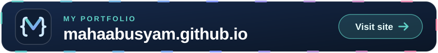

  

 

  I build responsive React and TypeScript applications and care about clean state management, data validation and accessible UI.

  
  
  

  

## Featured projects

<table>
  <tr>
    <td width="50%" align="center">
      
       <a href="https://prompt-lab-ivory.vercel.app/">Live demo</a> · <a href="https://github.com/mahaabusyam/PromptLab">Code</a>
    </td>
    <td width="50%" align="center">
      
       <a href="https://tour-guide-eng-maha.vercel.app/">Live demo</a> · <a href="https://github.com/mahaabusyam/tour-guide">Code</a>
    </td>
  </tr>
  <tr>
    <td width="50%" align="center">
      
       <a href="https://tradix-amber.vercel.app/">Live demo</a> · <a href="https://github.com/mahaabusyam/tradix">Code</a>
    </td>
    <td width="50%" align="center">
      
       <a href="https://mahaabusyam.github.io/mini-store/">Live demo</a> · <a href="https://github.com/mahaabusyam/mini-store">Code</a>
    </td>
  </tr>
</table>

## Tech stack

  
  
  
  
  
  
  
  
  
  
  

Also: React Router, React Hook Form, Zod, Axios, Vitest, Bootstrap 5.

## Currently

- Building a full TypeScript mini store (strict mode, typed state and runtime validation)
- Practicing for Frontend junior interviews

 

