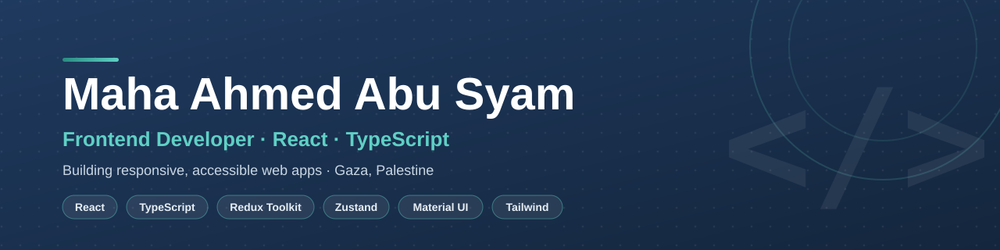

  

 
Frontend Developer · React · TypeScript

Building responsive, accessible and thoughtfully engineered web applications.

 
&nbsp;

 ---

👩‍💻 About Me

I'm a fifth-year Computer Systems Engineering student, graduating in 2027, focused on Frontend Development.

I build modern web applications with React and TypeScript, with a strong interest in clean architecture, typed state management, validation, accessibility and responsive UI.

Currently open to Frontend Junior opportunities.

---

🚀 Featured Projects

<table>
  <tr>
    <td width="50%" valign="top">⚡ PromptLab

Local-first AI prompt workspace with versioning, templates, favorites and side-by-side comparison.

React 19 · TypeScript · Zustand · Zod · Tailwind CSS

<a href="https://prompt-lab-ivory.vercel.app/">Live Demo</a> ·
<a href="https://github.com/mahaabusyam/PromptLab">Source Code</a>

</td><td width="50%" valign="top">🌍 Tour Guide

Tourism platform with city-based activities, trip details and URL-driven filtering.

React · Redux Toolkit · Material UI

<a href="https://tour-guide-eng-maha.vercel.app/">Live Demo</a> ·
<a href="https://github.com/mahaabusyam/tour-guide">Source Code</a>

</td>
</tr><tr>
<td width="50%" valign="top">📈 Tradix

Responsive trading dashboard featuring market data, charts, transactions and dashboard views.

React · Redux Toolkit · Material UI · MUI X Charts

<a href="https://tradix-amber.vercel.app/">Live Demo</a> ·
<a href="https://github.com/mahaabusyam/tradix">Source Code</a>

</td><td width="50%" valign="top">🛍️ Mini Store

Modern e-commerce application with cart management, wishlist and checkout flow.

React 19 · Redux Toolkit · Material UI

<a href="https://mahaabusyam.github.io/mini-store/">Live Demo</a> ·
<a href="https://github.com/mahaabusyam/mini-store">Source Code</a>

</td>
</tr>
</table>---

🧩 Tech Stack

 
Also working with

"React Router" · "React Hook Form" · "Zod" · "Axios" · "Vitest" · "Bootstrap 5"

---

🔭 Currently

Building     →  TypeScript applications with strict typing
Improving    →  React architecture & frontend patterns
Practicing   →  Frontend Junior interviews
Exploring    →  Better UX, accessibility & scalable UI

---

📊 GitHub Activity

 

---

✦ BUILD · LEARN · CREATE ✦

Turning ideas into interfaces.

 

